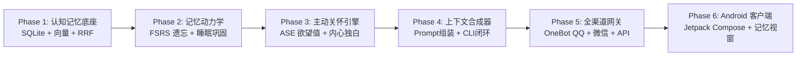

# AI 伴侣项目全景开发路线图 (Development Roadmap)

> 本文档规范了项目的分模块开发目标、核心参考项目对象、关键技术方案与推进时序，作为各阶段迭代的工程执行标准。

---

## 总体推进阶段图谱



---

## 阶段一：认知记忆底座与混合检索（Phase 1: Memory Foundation & Retrieval）

### 1. 开发目标
- 建立顶层 Rust Workspace（`Cargo.toml`）与核心库 `crates/app_core`。
- 实现基于 SQLite 的单文件全功能存储架构（All-in-One）：
  - **L0 工作记忆表 (`conversations`)**：滑动窗口内的原始发言，记录角色（User/Assistant）、时间戳、会话会话 ID。
  - **L1 情景记忆表 (`episodic_memories`)**：具体事件记录，包含内容、发生时间戳、情绪标记、向量嵌入（BLOB）、FSRS 状态参数（$S, R, D$）。
  - **L2 语义事实表 (`semantic_facts`)**：三元组或结构化属性 `(entity, attribute, value, confidence)`，挂载 SQLite FTS5 全文检索。
  - **L3 叙事记忆表 (`narratives`)**：时间线日记与阶段总结（日摘要/周回顾）。
  - **L4 核心画像表 (`profiles`)**：用户底色事实（不参与遗忘）与伴侣人设底色。
- 集成纯 Rust 向量计算管线：采用 `fastembed-rs` (驱动 `bge-small-zh-v1.5`，几十 MB 紧凑模型)，实现本地 CPU 毫秒级语义向量化。
- 实现 **RRF (Reciprocal Rank Fusion)** 互惠排名算法，将向量余弦相似度与 SQLite FTS5 BM25 词法得分无缝混合。

### 2. 参考对象
- **`references/eidetic-memory/`**：
  - 核心借鉴：`memory_server/` 中的 SQLite 数据库表设计、分层存储划分与读写抽象。
- **`references/giftia/`**：
  - 核心借鉴：RRF 互惠排名标准融合公式与 Top-K 重排过滤。
- **`references/AMBRACE/`**：
  - 核心借鉴：`bge-m3` 与 BM25 双路召回在实际对话检索中的权重配比。

### 3. 验收标准
- 单元测试覆盖：能够在纯内存或本地 SQLite 中写入事实与事件。
- 给定 Query（如 *“我最爱喝什么饮品”*），RRF 混合检索能准确从海量记忆中召回相关 L1/L2 记录并完成综合打分。

---

## 阶段二：记忆动力学、FSRS 遗忘与睡眠巩固（Phase 2: Dynamics & Consolidation）

### 1. 开发目标
- 实现 **FSRS (Free Spaced Repetition Scheduler)** 遗忘数学模型：
  - 记忆状态三元组建模：稳定性 $S$、可提取度 $R \in [0.0, 1.0]$、难度 $D$。
  - 提取概率随时间衰减计算：$R(t, S) = \left(1 + \text{factor} \cdot \frac{t}{S}\right)^{-1}$。
  - **提取强化（Recall Reinforcement）**：每次对话成功唤醒记忆并在回复中引用时，调用强化算法更新 $S$（遗忘边缘被记起的事件，稳定性跃升幅度更大）。
  - **自我遗忘机制**：当事件的可提取度 $R < 0.1$ 且长期未被激活时，标记为归档，移出高频检索池。
- 实现 **后台睡眠巩固守护进程（Sleep Consolidation Worker）**：
  - 定时/空闲触发：检测到夜间 3~4 点或系统连续静默 3 小时以上时启动。
  - **记忆回放与压缩（Replay & Condensation）**：扫描当日 L0 原始会话，提炼出原子事实存入 L2，更新阶段叙事存入 L3。
  - **事实冲突消解（Contradiction Resolution）**：新旧事实冲突时（如旧：“爱吃牛肉”，新：“最近吃素”），调低旧事实置信度或添加有效期标签。

### 2. 参考对象
- **`references/HIMF-release/`**：
  - 核心借鉴：角色扮演/伴侣领域中 FSRS 状态转移方程的移植与工程化参数。
- **`references/Sora-mem/`**：
  - 核心借鉴：热度衰减（Heat Decay）设计与异步巩固合并流程（Consolidation Worker）。
- **`references/yusi/`**：
  - 核心借鉴：人生图谱设计规范，杜绝垃圾日志堆砌，确保“会提炼、会遗忘”。

### 3. 验收标准
- 时间跳变模拟测试：模拟经过 1 天、7 天、30 天，特定记忆的 $R$ 值正确衰减；被频繁唤醒的记忆稳定性 $S$ 显著提高。
- 模拟睡眠巩固测试：输入一段杂乱的 10 轮对话，后台巩固器能自动生成结构化 L2 事实，并将 L0 归档。

---

## 阶段三：主动交互与内心独白：ASE 决策引擎（Phase 3: Proactive ASE Engine）

### 1. 开发目标
- 实现 **ASE (Active Spontaneous Expression)** 自发表达引擎：
  - 摒弃死板的固定闹钟轮询，设计基于欲望值 $U(t)$ 的自发表达模型：
    $$U(t) = w_t \cdot \ln(1 + \Delta t) + \sum w_i \cdot \text{OpenLoop}_i - \text{SleepInhibition}$$
  - **$\Delta t$（静默时长）**：随用户未联系时间呈对数递增。
  - **$\text{OpenLoop}_i$（未闭环关怀事件）**：如记录有“下午 2 点用户去面试”，面试结束后该项提供高额欲望加成。
  - **$\text{SleepInhibition}$（作息抑制）**：根据用户日常睡眠作息曲线施加惩罚，防止深夜扰民。
- 实现 **内心独白与自省机制（Internal Monologue）**：
  - 欲望值突破阈值时，不直接发送消息，而是触发轻量级 LLM 内心独白评估：
    *“我现在想找他说话。评估当前时间与他的状态：他昨晚熬夜且刚下班，现在去发消息会打扰他吗？还是应该发一句温馨的提醒？”*
  - 根据自省结论，选择“继续按捺等待（抑制欲望）”或“生成主动问候（触发发信）”。
- 状态机集成：维系好感度数值（Affection）、亲密度阶段（Stranger $\to$ Acquaintance $\to$ Close Friend $\to$ Soulmate）、伴侣实时心境。

### 2. 参考对象
- **`references/Shikigami-Protocol/`**：
  - 核心借鉴：ASE 架构设计、自发开口阈值判定算法与内心独白提示词结构。
- **`references/AMBRACE/`**：
  - 核心借鉴：主动关怀时机的触发场景与情感连贯性控制。
- **`references/Muse/`**：
  - 核心借鉴：多天未联系时的关系阶段平滑过渡与回归问候策略。

### 3. 验收标准
- 离线驱动测试：模拟用户失联 12 小时且存在未闭环事件时，引擎能触发内心独白并正确生成上下文相关的关心语句；在深夜时段能被自动抑制。

---

## 阶段四：上下文合成器与核心对话闭环（Phase 4: Synthesis & Core Loop）

### 1. 开发目标
- 实现 **上下文合成器（Context Synthesizer）**：
  - 动态提示词编排工程：
    ```text
    [System Persona] (角色基础底色、语气风格、当前好感度与心境)
    [Core Profile]   (L4 用户的根本特征与重要约定，不可磨灭)
    [Retrieved Memory] (经过 RRF 筛选出的前 Top-5 相关 L1 事件与 L2 事实)
    [Working Context]  (最近 L0 对话滑动窗口)
    [Inner Guidance]   (如有：内心独白对本轮对话的潜意识指引)
    ```
- 实现 **LLM 编排层（LLM Orchestration）**：
  - 兼容 OpenAI 格式 API（适配 DeepSeek、Claude、通义千问、本地 Ollama 等）。
  - 支持流式输出（Streaming SSE）、Token 消耗统计与超时熔断。
  - 结构化 Tool Use / Function Calling：允许 LLM 在对话中显式触发记忆强化或标记待办事件。
- 搭建 **CLI 快速原型交互工具（`tests/cli_preview`）**：
  - 在接入复杂 GUI 和聊天机器人前，在终端直接跑通“对话 $\to$ 检索记忆 $\to$ 回复 $\to$ 遗忘更新”全流程。

### 2. 参考对象
- **`references/yusi/`**：
  - 核心借鉴：上下文提示词装配规范，控制 Token 预算与记忆密度。
- **`references/eidetic-memory/`**：
  - 核心借鉴：三层召回结果的格式化注入技巧。

### 3. 验收标准
- 运行 `cargo run --bin cli_preview`，能在命令行与伴侣自由对话；能展示每轮对话注入了哪些记忆，回答后能否正确提炼新记忆。

---

## 阶段五：全渠道网关适配（QQ、微信、Web/App API）（Phase 5: Multi-Channel Gateway）

### 1. 开发目标
- 建立网络服务模块 `crates/gateway`（基于 Axum + Tokio）：
- **统一身份枢纽（Unified Identity Hub）**：
  - 将各渠道账号映射至统一伴侣所有者 ID：`QQ(uin) | WeChat(openid) | App(token) -> UserID`。
- **QQ 渠道接入（OneBot v11）**：
  - 建立反向 WebSocket 服务端，无缝对接 **NapCatQQ** 或 **Lagrange**。
  - 解析 OneBot 事件流：私聊消息、群聊@提及、撤回事件、语音/图片转码。
  - 支持出站消息队列（Outbound Queue）与主动消息推送。
- **微信渠道接入（WeChat Adapter）**：
  - 对接 Gewechat / iPad 协议网关 Webhook，或企业微信自建应用 Webhook。
  - 统一进出站消息格式至系统的抽象消息总线（`UnifiedMessage`）。
- **REST & WebSocket API**：
  - 提供给 Android 客户端和管理界面的标准接口（流式对话、记忆树查询、状态拉取）。

### 2. 参考对象
- **`references/Muse/`**：
  - 核心借鉴：多渠道通信协议层抽象模式，微信、QQ、飞书的统一事件派发。
- **`references/AMBRACE/`**：
  - 核心借鉴：外部聊天机器人适配器与 WebSocket 消息总线。

### 3. 验收标准
- 启动 NapCatQQ 容器并配置反向 WS，能在真实 QQ 聊天框中与伴侣对话；伴侣主动关怀能够直接推送到 QQ。

---

## 阶段六：Android 原生客户端与多模态扩展（Phase 6: Android App & Multimodal）

### 1. 开发目标
- 在 `apps/android_app` 搭建原生应用工程（Kotlin + Jetpack Compose + Material 3）：
- **通信双通道支持**：
  - 远程连接模式：通过 WebSocket 保持长连接，支持流式打字机效果输出。
  - 本地内嵌模式（可选）：借助现有 `env/` 的 UniFFI 交叉编译链，直接将 `app_core` 打成 `.so` 内嵌于手机本地。
- **特色功能界面**：
  - **灵动聊天界面**：Markdown 渲染、表情包展示、语音波形与输入。
  - **记忆透视窗（Mind / Memory Inspector）**：用户可翻阅“伴侣记住了我什么”（L1 事件列表、L2 属性卡片），支持用户一键手动更正或删除错误记忆。
  - **情绪与好感度看板**：直观展示伴侣当前的情绪状态、亲密等级与相识天数。
- **后台常驻与保活通知**：
  - Android 前台服务（Foreground Service）+ WebSocket 心跳，保证主动关怀消息第一时间到达系统通知栏。

### 2. 参考对象
- **`references/Muse/`**：
  - 核心借鉴：Android 原生 Jetpack Compose 布局风格、本地数据库管理与网络同步结构。
- **`references/AMBRACE/`**：
  - 核心借鉴：移动端语音交互体验与记忆可视化展示界面。

### 3. 验收标准
- Android 真机/模拟器安装运行，能与伴侣流畅交流；通知栏能正常接收 ASE 引擎发出的主动关怀推送；在记忆管理页可查阅修改 SQLite 中的记忆条目。

---

## 阶段顺序与依赖关系对照表

| 顺序 | 阶段名称 | 核心输出成果 | 前置依赖 | 建议工期 |
| :---: | :--- | :--- | :--- | :---: |
| **P1** | **认知记忆底座** | Workspace、SQLite Schema (L0~L4)、FastEmbed 向量、RRF 检索 | 无 | 第 1~2 周 |
| **P2** | **记忆动力学** | FSRS 衰减计算器、提取强化函数、深夜睡眠巩固守护进程 | P1 | 第 3 周 |
| **P3** | **ASE 主动关怀** | 欲望值评估模型、内心独白 Chain、情绪/亲密度状态机 | P1, P2 | 第 4 周 |
| **P4** | **上下文合成与闭环** | 动态 Prompt 组装器、OpenAI 流式集成、`cli_preview` 终端交互 | P1, P2, P3 | 第 5 周 |
| **P5** | **全渠道网关** | OneBot v11 反向 WS (QQ)、微信适配器、REST/WS 统一接口 | P4 | 第 6 周 |
| **P6** | **Android 原生端** | Jetpack Compose 客户端、记忆透视修改器、系统通知保活 | P5 (或 P4) | 第 7~8 周 |
